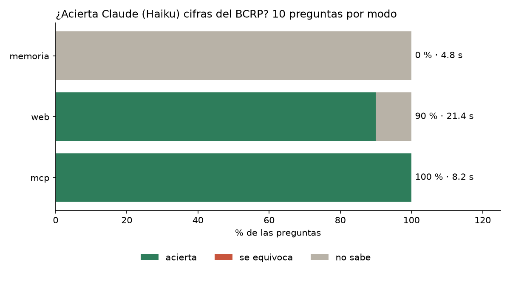

# Informe · MCP del BCRP

Melina Rozas · Sesión 04, Data Science con Python · 28 de octubre de 2026

## Qué construí

`server.py` es un servidor MCP hecho con FastMCP 4 que expone las 17,167 series del BCRP. Pasa las 8 pruebas de
`test_server.py` (`uv run pytest -q` → `8 passed`).

| Primitiva | Nombre | Para qué sirve |
|---|---|---|
| Herramienta | `buscar_series` | Encuentra el código de una serie por palabras (venía hecha) |
| Herramienta | `serie` | Datos entre dos fechas, en cualquier frecuencia (diaria, mensual, trimestral, anual), con la URL de la fuente |
| Herramienta | `resumen` | Primero, último, cambio, variación %, promedio, máximo y mínimo, para que el modelo no haga cuentas |
| Herramienta propia | `comparar_paises` | Compara al Perú con otros países usando la API del Banco Mundial (crecimiento, inflación, desempleo…). El BCRP solo tiene datos del Perú |
| Herramienta propia | `correlacion` | Correlación entre dos series del BCRP en los periodos que comparten |
| Recurso | `bcrp://serie/{codigo}` | La ficha de una serie: se adjunta con `@bcrp:bcrp://serie/PN01273PM` |
| Prompt | `informe(tema)` | Informe de 5 viñetas que cita código y periodo de cada cifra: `/mcp__bcrp__informe inflación` |

Además, `serie` reintenta con espera cuando el BCRP limita los pedidos (responde HTML en vez de JSON) y guarda en
caché lo que ya bajó. `.mcp.json` conecta `bcrp` y `fetch`, sin claves.

## Resultados

`uv run evaluar.py --modos memoria web mcp`: 10 preguntas (8 del curso y 2 mías), el mismo modelo (Haiku) y tres
formas de responder, 30 llamadas a `claude -p`. La corrida completa está en `resultados.csv`.

| Modo | Acierta | Se equivoca | No sabe | Segundos por pregunta |
|---|---|---|---|---|
| Solo memoria | 0 | 0 | 10 | 4.8 |
| Búsqueda web | 9 | 0 | 1 | 21.4 |
| MCP del BCRP | **10** | 0 | 0 | 8.2 |

**Memoria (0/10).** Haiku no conoce cifras de 2025 y 2026. Como la instrucción le permitía responder `null`, dijo
«no sé» las 10 veces en vez de inventar.

**Web (9/10).** Falló el precio del cobre de agosto de 2026: buscó en el BCRP, pero encontró una serie anual y no la
mensual (`PN38784BM`), así que respondió que no sabía. De los 9 aciertos, 5 no salen del BCRP sino del INEI o de la
prensa (Finanzas Digital, El Comercio). Además devuelve cifras redondeadas (4.55 en vez de 4.5487), que entran por
la tolerancia. Es casi 3 veces más lenta que el MCP: lee varias páginas antes de responder.

**MCP (10/10).** Acertó todo, y cada respuesta trae el código de la serie, el periodo y la URL de la API del BCRP,
así que se puede verificar. En todas usó 4 o 5 turnos: `buscar_series` para encontrar el
código y luego `serie` o `resumen`.

**Mis dos preguntas.** Desempleo de Lima en setiembre de 2026 y exportaciones de oro en agosto de 2026: memoria no
supo ninguna, y web y MCP acertaron las dos.

## Dos cifras comprobadas a mano en la web del BCRP

| Pregunta | Mi MCP | Web del BCRP | Tabla |
|---|---|---|---|
| Desempleo en Lima Metropolitana, set-2026 (`PN38063GM`) | 4.3717 % | 4.4 % | [estadisticas.bcrp.gob.pe](https://estadisticas.bcrp.gob.pe/estadisticas/series/mensuales/resultados/PN38063GM/html/2026-6/2026-9/) |
| Exportaciones de oro, ago-2026 (`PN38791BM`) | 3,034.7 millones US$ | 3,035 millones US$ | [estadisticas.bcrp.gob.pe](https://estadisticas.bcrp.gob.pe/estadisticas/series/mensuales/resultados/PN38791BM/html/2026-6/2026-9/) |

La web redondea (a un decimal el desempleo y a enteros las exportaciones), por eso en `preguntas.csv` la tolerancia
es 0.06 y 1, que cubren ese redondeo.

## Conclusión

- Sin herramientas, el modelo no sirve para cifras recientes. Lo mejor que puede hacer es decir que no sabe.
- La búsqueda web casi alcanza al MCP en aciertos, pero tarda casi 3 veces más, depende de encontrar la página
  correcta y muchas veces cita a un intermediario en vez de la fuente oficial.
- Vale la pena construir un MCP cuando se consulta seguido la misma fuente de datos y cada cifra tiene que poder
  rastrearse hasta su origen. La búsqueda web basta para preguntas sueltas o para fuentes que no tienen API.
- Lo que más ayuda no es que el modelo «sepa más», sino que las cuentas y los datos salgan de código que se puede
  probar (`test_server.py`) y repetir.
